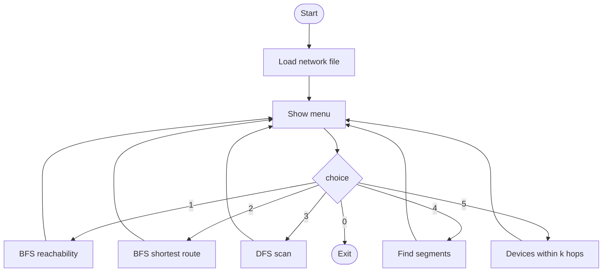

# Application - Graph Exploration / Network Traversal System

## Problem Statement

Build a small tool that explores a computer network modelled as a graph (devices = vertices, links = edges) and answers: *what can a device reach, what is the best route, which parts of the network are cut off, and what is within k hops?*

## Algorithm / Approach

The network is read from a text file (`DeviceA DeviceB` per line) and stored in an `AdjacencyList`; a `Network` class maps device names to vertex numbers.

| Feature | Algorithm |
|---|---|
| Reachability with hop counts | BFS levels |
| Fewest-hop route | BFS + parent array |
| Network scan order | Iterative DFS |
| Disconnected segments | Connected components (BFS) |
| Devices within k hops | BFS with distance <= k |

Input validation: unknown device names are rejected with the list of valid names, malformed file lines report the line number, and missing files give a clear error.

## Pseudocode / Flowchart

```text
LOAD(file)  -> links ; assign a number to each new device name ; build AdjacencyList
ROUTE(a, b) -> result <- BFS(G, a) ; if dist[b] = -1: "no route" else rebuild path from parent[]
SEGMENTS()  -> components <- CONNECTED-COMPONENTS(G)
```



## Time & Space Complexity Analysis

Every feature is a single BFS/DFS: **O(V + E)** time and **O(V)** extra space. Loading the file is O(L log D) for L links (sorted adjacency insertion).

## Sample Input / Output

Network file: `network.txt` (14 devices, 13 links, two segments).  `python network_explorer.py --demo`

```text
Loaded network: 14 devices, 13 links

Devices reachable from Gateway (by hop count):
  0 hop(s): Gateway
  1 hop(s): Firewall
  2 hop(s): CoreSwitch
  3 hop(s): LabSwitch, LibrarySwitch, AdminSwitch
  4 hop(s): PC1, PC2, PC3, PC4, Server1, PC5
  Not reachable: PrinterA, PrinterB

Fewest-hop route (4 hops): Gateway -> Firewall -> CoreSwitch -> LibrarySwitch -> PC4

No route between Gateway and PrinterA.

DFS scan order from Gateway: Gateway -> Firewall -> CoreSwitch -> LabSwitch -> PC1 -> PC2 -> PC3 -> LibrarySwitch -> AdminSwitch -> Server1 -> PC5 -> PC4

The network has 2 connected segment(s):
  Segment 1 (12 devices): Gateway, Firewall, CoreSwitch, LabSwitch, LibrarySwitch, AdminSwitch, PC1, PC2, PC3, PC4, Server1, PC5
  Segment 2 (2 devices): PrinterA, PrinterB

Devices within 1 hop(s) of CoreSwitch: Firewall, LabSwitch, LibrarySwitch, AdminSwitch
```

## Screenshots / Graphs

_Add a screenshot of the interactive menu (`python network_explorer.py`) here._

## Experimental Results

Functional test on the sample network: all five features give the expected results (e.g. the Printer segment is correctly reported as unreachable from the Gateway).

## Learning Outcomes

* Apply BFS and DFS to a realistic problem and reuse earlier modules.
* Map real-world entities (names) to graph vertices.
* Build a menu-driven tool with proper input validation and error handling.
