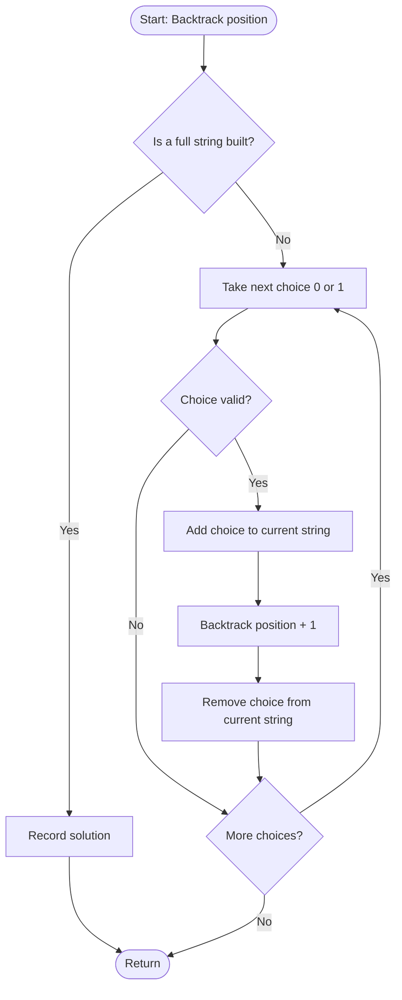

# General Backtracking Technique

## Problem Statement
Demonstrate the general backtracking technique on a simple problem: generate all binary strings of length `n` that do **not** contain two consecutive `1`s.

## Algorithm / Approach
Backtracking builds a solution one step at a time and abandons a partial solution as soon as it cannot lead to a valid answer. Every backtracking program follows the same four steps:

1. **Choose** - extend the partial solution with one option (`0` or `1`).
2. **Check** - if the constraint is violated (a `1` right after a `1`), prune this branch immediately.
3. **Explore** - recurse to fill the next position.
4. **Un-choose** - remove the option and try the next one (this "going back" gives the technique its name).

Because invalid prefixes are never expanded, far fewer nodes are visited than in the full state-space tree.

## Pseudocode
```
BACKTRACK(position, current):
    if position == n:
        record current as a solution
        return
    for choice in {0, 1}:
        if IS_VALID(current, choice):      // constraint check (pruning)
            current.append(choice)         // choose
            BACKTRACK(position + 1, current)   // explore
            current.removeLast()           // un-choose (backtrack)

IS_VALID(current, choice):
    return NOT (choice == 1 AND current ends with 1)
```

## Flowchart


## Time & Space Complexity
| | |
|---|---|
| Time | O(number of valid prefixes). The number of valid strings is the Fibonacci number F(n+2), so this is about O(1.618^n), much better than the O(2^n) of the full tree. |
| Space | O(n) for the recursion stack and the current string |

## Sample Input / Output
```
Enter string length n (1 to 25): 3
Valid strings:
  000
  001
  010
  100
  101

Valid strings (no two consecutive 1s) = 5
Nodes visited with backtracking        = 11
Nodes in the full tree (no pruning)    = 15
```

## Screenshots / Graphs
_Add a terminal screenshot here: `screenshots/output.png`_

## Experimental Results
| n | Valid strings | Nodes with backtracking | Nodes in full tree |
|---|---|---|---|
| 3 | 5 | 11 | 15 |
| 4 | 8 | 19 | 31 |
| 20 | 17,711 | 46,366 | 2,097,151 |

The gap between the two node counts grows quickly with `n`, which shows how much pruning saves.

## Learning Outcomes
- Understand the choose / check / explore / un-choose template used by all backtracking programs.
- See how early constraint checking (pruning) shrinks the search space.
- Relate a backtracking run to a state-space tree.

## How to Run
```
g++ -std=c++17 general_backtracking.cpp -o general_backtracking
./general_backtracking
```
