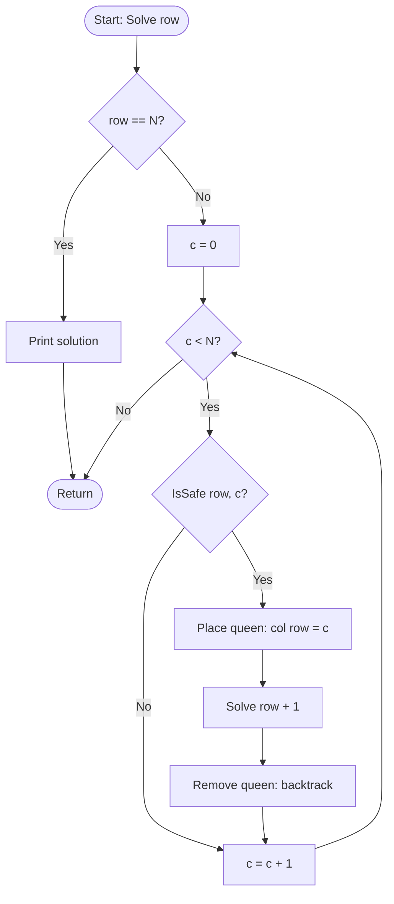

# 4-Queens Problem

## Problem Statement
Place 4 queens on a 4 x 4 chessboard so that no two queens attack each other, i.e. no two queens share a row, a column or a diagonal. Find all solutions.

## Algorithm / Approach
- Queens are placed **row by row**, so two queens can never share a row.
- `col[r]` stores the column of the queen in row `r`.
- For row `r` try every column `c`. The square is **safe** if no earlier queen is in column `c` or on the same diagonal (`|col[i] - c| == r - i`).
- If a safe square is found, place the queen and move to the next row. If no column works, **backtrack** to the previous row and move its queen.
- When row `N` is reached, a solution has been found.

## Pseudocode
```
SOLVE(row):
    if row == N:
        print board; count = count + 1
        return
    for c = 0 to N - 1:
        if IS_SAFE(row, c):
            col[row] = c            // place queen
            SOLVE(row + 1)
            col[row] = -1           // remove queen (backtrack)

IS_SAFE(row, c):
    for i = 0 to row - 1:
        if col[i] == c or |col[i] - c| == row - i:
            return false
    return true
```

## Flowchart


## Time & Space Complexity
| | |
|---|---|
| Time | O(N!) in the worst case (each row has fewer free columns), far less in practice because of pruning |
| Space | O(N) |

## Sample Input / Output
No input is needed.
```
Solution 1:
. Q . .
. . . Q
Q . . .
. . Q .

Solution 2:
. . Q .
Q . . .
. . . Q
. Q . .

Total solutions for 4-Queens = 2
```

## Screenshots / Graphs
_Add a terminal screenshot here: `screenshots/output.png`_

## Experimental Results
The program finds exactly **2** solutions, which is the known answer for N = 4 (the two are mirror images of each other).

## Learning Outcomes
- Model a placement problem as a row-by-row state-space search.
- Implement the safe-square check using column and diagonal rules.
- See backtracking undo a placement and try the next option.

## How to Run
```
g++ -std=c++17 four_queens.cpp -o four_queens
./four_queens
```
