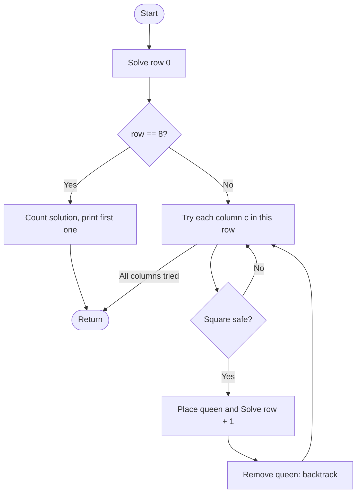

# 8-Queens Problem

## Problem Statement
Place 8 queens on a standard 8 x 8 chessboard so that no two queens attack each other. Count all solutions and display the first one. Optionally list all of them.

## Algorithm / Approach
Same row-by-row backtracking as the 4-Queens program with `N = 8`:
1. Place one queen in each row; `col[r]` is the queen's column in row `r`.
2. A square is safe if no earlier queen shares its column or diagonal.
3. When all 8 rows are filled, record a solution, then **backtrack** to find the remaining ones.

Each solution can be written compactly as the list of columns, e.g. `0 4 7 5 2 6 1 3`.

## Pseudocode
```
SOLVE(row):
    if row == 8:
        count = count + 1
        if count == 1: print the board
        return
    for c = 0 to 7:
        if IS_SAFE(row, c):
            col[row] = c
            SOLVE(row + 1)
            col[row] = -1      // backtrack
```

## Flowchart


## Time & Space Complexity
| | |
|---|---|
| Time | O(N!) worst case. Brute force would examine 8^8 = 16,777,216 placements, but backtracking visits only about two thousand nodes (see the Analysis folder). |
| Space | O(N) |

## Sample Input / Output
```
List all 92 solutions? (y/n): y
First solution:
Q . . . . . . .
. . . . Q . . .
. . . . . . . Q
. . . . . Q . .
. . Q . . . . .
. . . . . . Q .
. Q . . . . . .
. . . Q . . . .

All solutions (column of the queen in each row):
1: 0 4 7 5 2 6 1 3
2: 0 5 7 2 6 3 1 4
...
92: 7 3 0 2 5 1 6 4

Total solutions for 8-Queens = 92
```

## Screenshots / Graphs
_Add a terminal screenshot here: `screenshots/output.png`_

## Experimental Results
The program finds **92** solutions, matching the known result (12 of them are fundamentally distinct, the rest are rotations and reflections).

## Learning Outcomes
- Apply backtracking to a classic benchmark problem and verify it against the known answer.
- Appreciate how pruning makes an otherwise huge search space tractable.
- Represent a board compactly as an array.

## How to Run
```
g++ -std=c++17 eight_queens.cpp -o eight_queens
./eight_queens
```
