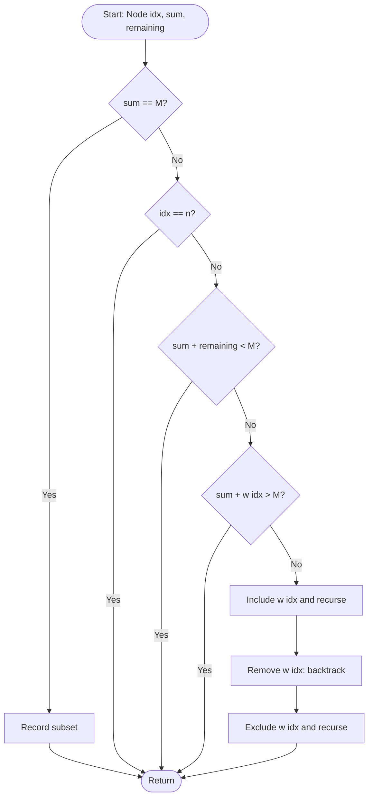

# Sum of Subsets

## Problem Statement
Given `n` positive integers and a target sum `M`, find **all** subsets whose elements add up exactly to `M`.

## Algorithm / Approach
Backtracking on a binary state-space tree: for each item decide **include** or **exclude**.

1. Sort the items in ascending order.
2. Keep `sum` (chosen so far) and `remaining` (sum of the undecided items).
3. Record a solution when `sum == M`.
4. **Prune** a node when
   - `sum + remaining < M` - even taking everything left cannot reach `M`, or
   - `sum + w[idx] > M` - the next item (and every later one, as the list is sorted) is too large.
5. Otherwise branch: include `w[idx]`, recurse, remove it (backtrack), then exclude it and recurse.

## Pseudocode
```
SUM_OF_SUBSETS(idx, sum, remaining):
    if sum == M:
        record chosen subset
        return
    if idx == n: return
    if sum + remaining < M: return           // pruning rule 1
    if sum + w[idx] > M: return              // pruning rule 2
    chosen.add(w[idx])                       // include
    SUM_OF_SUBSETS(idx + 1, sum + w[idx], remaining - w[idx])
    chosen.removeLast()                      // backtrack
    SUM_OF_SUBSETS(idx + 1, sum, remaining - w[idx])   // exclude
```

## Flowchart


## Time & Space Complexity
| | |
|---|---|
| Time | O(2^n) in the worst case (full state-space tree); usually far fewer nodes because of pruning |
| Space | O(n) recursion depth |

## Sample Input / Output
```
Enter the number of items (1 to 30): 6
Items: 5 10 12 13 15 18
Enter the target sum M (positive): 30

Sorted items: 5 10 12 13 15 18
Target sum M = 30
Solution 1: { 5 10 15 }
Solution 2: { 5 12 13 }
Solution 3: { 12 18 }
Number of solutions = 3
Nodes explored      = 41 (full tree without pruning: 127)
```
When no subset exists: `No subset adds up to 9.`

## Screenshots / Graphs
_Add a terminal screenshot here: `screenshots/output.png`_

## Experimental Results
The solution count was compared with a brute-force check of all `2^n` subsets on 300 random inputs and matched every time. In the example above, pruning reduces the explored nodes from 127 to 41.

## Learning Outcomes
- Design pruning rules ("bounding functions") for a subset-selection problem.
- Understand why sorting the input makes a stronger pruning rule possible.
- Compare the explored nodes with the full state-space tree.

## How to Run
```
g++ -std=c++17 sum_of_subsets.cpp -o sum_of_subsets
./sum_of_subsets
```
