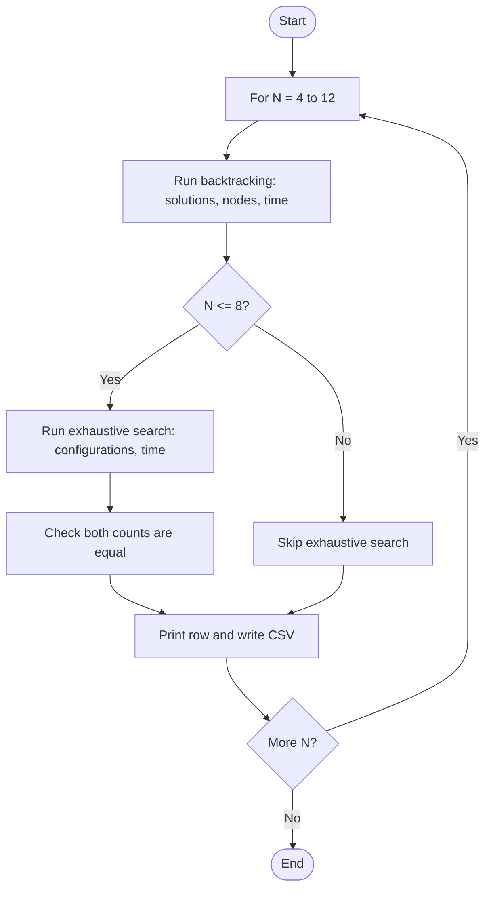
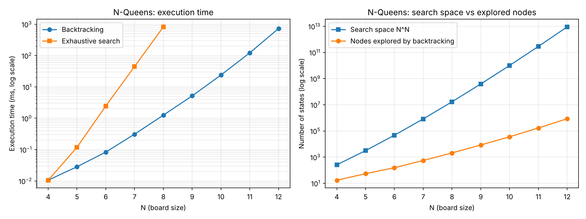

# Backtracking Analysis: Search Space, Solution Count and Execution Time

## Problem Statement
Analyse backtracking on the N-Queens problem:
- analyse the search-space complexity,
- count the possible solutions,
- measure execution time for different values of `N`,
- compare backtracking with exhaustive search.

## Algorithm / Approach
For each `N` the program runs two solvers on the same problem:

1. **Backtracking** - places queens row by row and prunes any square that is attacked (see `04-N-Queens`). It counts solutions, explored nodes and time.
2. **Exhaustive search** - tries all `N^N` ways to put one queen in every row (every column choice for every row) and checks each complete placement. It counts configurations checked, solutions and time. It is only run for `N <= 8` because it becomes far too slow after that.

The solution counts of the two methods are compared (`OK` in the table means they match), and all results are written to `backtracking_analysis.csv`. `plot_results.py` reads that file and draws the graphs.

## Pseudocode
```
for N = 4 to 12:
    (solutions, nodes, tBT) = BACKTRACKING(N)
    searchSpace = N^N
    if N <= 8:
        (solutionsEx, configs, tEx) = EXHAUSTIVE(N)      // checks every one of the N^N placements
        verify solutionsEx == solutions
    write N, solutions, searchSpace, nodes, tBT, configs, tEx to CSV

EXHAUSTIVE(N):
    for every assignment col[0..N-1] with each col[i] in 0..N-1:
        if no two queens share a column or diagonal: solutions++
```

## Flowchart


## Time & Space Complexity (Theory)
| Method | Search space | Time | Space |
|---|---|---|---|
| Exhaustive (one queen per row) | N^N configurations | O(N^N * N^2) | O(N) |
| One queen per row **and** column (permutations) | N! configurations | O(N!) | O(N) |
| Backtracking | far fewer nodes (prunes attacked squares early) | O(N!) worst case, much lower in practice | O(N) |

Backtracking never changes the worst-case bound, but it avoids expanding branches that can no longer lead to a solution, which gives a large practical speed-up.

## Sample Input / Output
No input is needed.
```
N   Solutions  N^N             BT nodes      BT ms       Exhaustive cfgs Exhaustive ms Match
-----------------------------------------------------------------------------------------------
4   2          256             17            0.0106      256             0.0105        OK
5   10         3125            54            0.0283      3125            0.1180        OK
6   4          46656           153           0.0829      46656           2.4581        OK
7   40         823543          552           0.3103      823543          44.6784       OK
8   92         16777216        2057          1.2532      16777216        821.8710      OK
9   352        387420489       8394          5.1753      -               -             -
10  724        10000000000     35539         23.9089     -               -             -
11  2680       285311670611    166926        122.2089    -               -             -
12  14200      8916100448256   856189        726.3536    -               -             -
```

## Screenshots / Graphs


_Left: execution time (log scale). Right: search space `N^N` versus nodes actually explored by backtracking (log scale). Re-run the program and `python plot_results.py` on your own machine to regenerate the graph with your timings._

## Experimental Results
- **Solution counts** (2, 10, 4, 40, 92, 352, 724, 2680, 14200) match the known values and both methods agree for `N <= 8`.
- **Search space vs explored nodes:** for `N = 8` exhaustive search checks 16,777,216 configurations while backtracking explores only 2,057 nodes (about 8,000 times fewer). For `N = 12` the space is about 8.9 x 10^12 but backtracking visits 856,189 nodes.
- **Execution time:** at `N = 8` backtracking took about 1.3 ms against 822 ms for exhaustive search (about 650 times faster). Exhaustive time grows by roughly 18x per step in `N`, so `N = 9` would already need many seconds and was not run.
- Backtracking time still grows exponentially (roughly 4 to 6 times per step in `N`), because the number of solutions and explored nodes grows exponentially, but at a much lower rate.
- Measurements were taken on one machine with an unoptimised (`-O0`) build; absolute times will differ on other machines.

## Learning Outcomes
- Understand how the size of the search space (`N^N`, `N!`) compares with the nodes a pruned search really visits.
- Verify a faster algorithm against a trusted slower one.
- Record experimental data in a CSV file, plot it, and relate empirical growth to theoretical complexity.

## How to Run
```
g++ -std=c++17 backtracking_analysis.cpp -o backtracking_analysis
./backtracking_analysis
pip install matplotlib pandas
python plot_results.py
```
