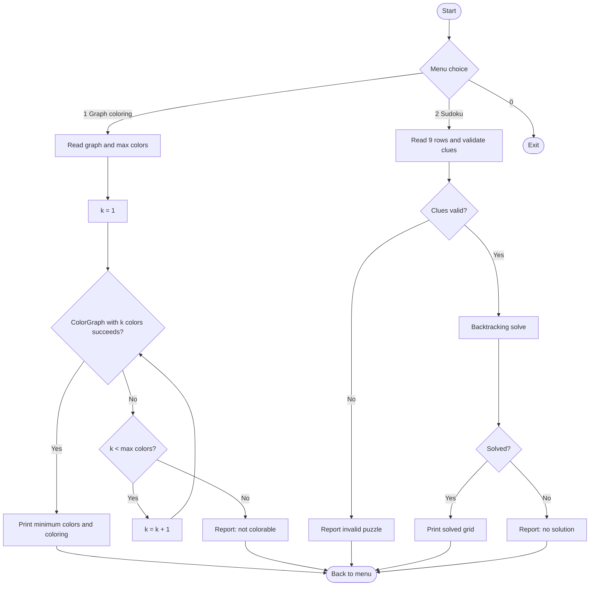

# Constraint Satisfaction Solver (Application)

## Problem Statement
Build a solver for Constraint Satisfaction Problems (CSPs) using backtracking. A CSP consists of **variables**, a **domain** of allowed values for each variable and **constraints** that every assignment must obey. The application solves two classic CSPs:

1. **Graph / Map Coloring** - color the vertices of a graph so that adjacent vertices get different colors, using as few colors as possible.
2. **Sudoku** - fill a 9 x 9 grid so that every row, column and 3 x 3 box contains each digit 1-9 exactly once.

## Algorithm / Approach
Both problems use the same backtracking idea: assign a value to one variable at a time, check the constraints, and **undo** the assignment if a dead end is reached.

**Graph coloring**
- Variables = vertices, domain = colors `1..k`, constraint = no neighbor has the same color.
- To find the minimum number of colors, try `k = 1, 2, 3, ...` and stop at the first `k` for which a coloring exists (the chromatic number).

**Sudoku**
- Variables = empty cells, domain = digits 1-9, constraint = digit is unique in its row, column and box.
- Find the next empty cell, try digits 1-9, keep the first safe one and recurse; if no digit fits, reset the cell and go back.
- The initial clues are validated first, so an invalid puzzle is rejected immediately.

## Pseudocode
```
COLOR_GRAPH(v, k):
    if v == V: return true
    for c = 1 to k:
        if no neighbor of v has color c:
            color[v] = c
            if COLOR_GRAPH(v + 1, k): return true
            color[v] = 0                  // backtrack
    return false

MIN_COLORS(maxColors):
    for k = 1 to maxColors:
        if COLOR_GRAPH(0, k): return k
    return NOT_POSSIBLE

SOLVE_SUDOKU(grid):
    find an empty cell (r, c); if none: return true
    for digit = 1 to 9:
        if digit is not in row r, column c or the box:
            grid[r][c] = digit
            if SOLVE_SUDOKU(grid): return true
            grid[r][c] = 0                // backtrack
    return false
```

## Flowchart


## Time & Space Complexity
| Problem | Time (worst case) | Space |
|---|---|---|
| Graph coloring with `k` colors | O(k^V) | O(V) |
| Sudoku | O(9^m), `m` = number of empty cells | O(1) extra (grid modified in place) |

Pruning (checking constraints before recursing) makes typical inputs run in milliseconds.

## Sample Input / Output
**Graph coloring (a 5-vertex cycle, which needs 3 colors):**
```
Number of vertices: 5     Number of edges: 5     Maximum colors to try: 4
Edges: 0-1, 1-2, 2-3, 3-4, 4-0

Minimum number of colors needed = 3
  Vertex 0 -> Color 1
  Vertex 1 -> Color 2
  Vertex 2 -> Color 1
  Vertex 3 -> Color 2
  Vertex 4 -> Color 3
Color assignments tried = 29, time = 0.002 ms
```
A complete graph on 4 vertices with a limit of 3 colors prints: `The graph cannot be colored with 3 colors or fewer.`

**Sudoku:**
```
Row 1: 530070000
Row 2: 600195000
Row 3: 098000060
Row 4: 800060003
Row 5: 400803001
Row 6: 700020006
Row 7: 060000280
Row 8: 000419005
Row 9: 000080079

Solved Sudoku:
5 3 4 | 6 7 8 | 9 1 2
6 7 2 | 1 9 5 | 3 4 8
1 9 8 | 3 4 2 | 5 6 7
------+-------+------
8 5 9 | 7 6 1 | 4 2 3
4 2 6 | 8 5 3 | 7 9 1
7 1 3 | 9 2 4 | 8 5 6
------+-------+------
9 6 1 | 5 3 7 | 2 8 4
2 8 7 | 4 1 9 | 6 3 5
3 4 5 | 2 8 6 | 1 7 9
Digit placements tried = 37652, time = 2.7 ms
```
Invalid input cases handled: repeated digit in the clues, a row that is not exactly 9 digits, invalid edges, and puzzles with no solution.

## Screenshots / Graphs
_Add terminal screenshots of both modes here: `screenshots/`_

## Experimental Results
- Graph coloring: on 150 random small graphs the minimum number of colors matched a brute-force search, and every printed coloring was valid.
- Sudoku: the classic example above is solved correctly in about 37,000 digit placements.
- Times are from one machine and will vary.

## Learning Outcomes
- Model real problems as variables, domains and constraints.
- Reuse the same backtracking template for different problems.
- Detect invalid or unsolvable inputs gracefully.
- Understand how a CSP solver is built and where heuristics (such as choosing the most constrained variable first) could improve it.

## How to Run
```
g++ -std=c++17 csp_solver.cpp -o csp_solver
./csp_solver
```
